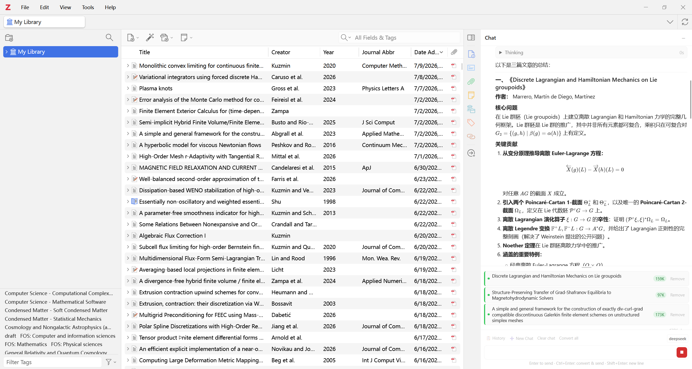

# ChatPDF for Zotero

[简体中文](README.zh-CN.md)

ChatPDF is a Zotero 7–10 add-on for reading and discussing research papers with an OpenAI-compatible language model. It adds a persistent chat panel and reads PDFs through cached page Markdown, with original-image review for formulas, tables and figures; extracted PDF text supports search and navigation.

## Project Scope

ChatPDF is developed primarily for personal use and is shared as-is. Zotero versions, operating systems, model providers, network/proxy setups, and individual research workflows vary, so the add-on may not work perfectly in every environment.

The source code is available for adaptation. You can use AI coding agents to help inspect errors and fine-tune ChatPDF for your own environment and workflow—for example, provider compatibility, interface behavior, page-reading behavior, or custom tools. Keep custom changes in version control, back up the cache, and test them with an isolated Zotero profile before using them with your daily library.

## Agent capabilities update

The agent searches local PDF text to locate evidence, then reads page Markdown. Missing pages are transcribed by the current model with thinking disabled, or a separately selected visual profile, and cached. No external OCR service is required. Search responses report inspected coverage and continuation cursors; unextractable or unavailable files remain explicit.

The chat window's library permission menu enables batch collection, subcollection, tag and bibliographic note changes, including deletion of empty collections. Moving all contents out and deleting the empty shell can share one batch; Undo restores the collection and memberships. Batch review is the default; reviews and completed receipts group readable changes with Undo. Child and standalone notes can be searched and read without PDF conversion. Source chips show direct PDF reading and provide a right-click/More menu to open or remove a source. The agent chooses tools and their order while the harness enforces scope, transactions and conflict detection. Stable system instructions/tool schemas and immutable provider history support context prefix reuse. See [Agent capabilities](docs/agent-capabilities.md).

## Features

- Chat with one or more Zotero PDFs without leaving Zotero.
- Search your Zotero library or remembered annotation text and add relevant papers from the conversation.
- Search PDF text locally and read relevant original pages, including formulas, figures and tables.
- Stream answers with Markdown, LaTeX, reasoning, tool activity, and token usage.
- Keep separate chat sessions, source lists, and background work in each Zotero window.
- Optionally search and fetch public web pages.
- Cache extracted text, rendered pages and chat history locally.
- Expose the same tools to external agents through the companion Zotero MCP.

## Requirements

- Zotero 7, 8, 9, or 10.0.
- An OpenAI-compatible chat model with tool calling. Page images need image-input support; missing capability metadata does not block chat.
- An API key for an OpenAI-compatible chat-completions service.

## Installation

1. Download `chat-pdf.xpi` from [GitHub Releases](https://github.com/ruijie-xi/zotero-chat-pdf/releases).
2. In Zotero, open **Tools → Add-ons**.
3. Open the gear menu and select **Install Add-on From File…**.
4. Choose the downloaded XPI and restart Zotero.

The first installation still uses the XPI file. Starting with the next release, Zotero can discover later ChatPDF versions through **Tools → Add-ons → Gear → Check for Updates…**, and can install them automatically when add-on updates are enabled. Your settings and chat history remain in the configured cache directory.

## Setup

Open **Edit → Settings → ChatPDF** on Windows/Linux or **Zotero → Settings → ChatPDF** on macOS.

At minimum, configure:

| Setting | Description |
| --- | --- |
| LLM Provider | DeepSeek, OpenCode Go, or Custom (the existing OpenAI-compatible configuration). |
| LLM API Base URL | Base URL for an OpenAI-compatible API. |
| LLM API Key | Bearer token for the model provider. |
| Model Name | A vision-capable model identifier accepted by the provider. |

The default API base and model target DeepSeek; existing settings and profiles remain **Custom**. Built-in providers fill in their endpoint and a default model. Provider selection is saved with each model profile. Switching providers keeps separate drafts while the settings pane is open and does not carry credentials or token overrides to a new provider. Save profiles to retain those configurations across restarts. Use **LLM API Test** to check the current endpoint and credentials.

**OpenCode Go** uses `https://opencode.ai/zen/go/v1` and a Go API key. Suggested DeepSeek IDs include `deepseek-v4.1-flash`, `deepseek-v4-pro`, and `deepseek-v4-flash`, without the `opencode-go/` prefix. ChatPDF sends its own client identity and a stable conversation header on main and auxiliary requests. Local token counts use the explicit DeepSeek V4 estimate. Known Go DeepSeek models use bundled catalogue capacities when `/models` omits them; endpoint metadata and manual overrides take precedence. Unknown models require explicit limits. [Go is intended for coding agents](https://opencode.ai/docs/go/#where-can-i-use-it); this integration does not guarantee service acceptance for paper-reading traffic.

Optional settings include thinking controls, iteration limits, context/output budgets, a per-image token reserve, cache location, system prompt, debug logging and web tools. Search uses PDF.js or a fresh Zotero text index locally. Brave Search is used when configured; otherwise web search falls back to DuckDuckGo.

The same model handles conversation and page reading. All enabled tools are available without a vision confirmation step. An explicit image-input rejection switches the current native session/model to text, with a visible notice. Current fields take effect immediately. Replacing or clearing the API key of a loaded profile also updates that profile, so switching away and back does not restore its old key. Other named-profile edits and system prompts have explicit save controls.

History searches chat/paper titles and visible message text, shows matching excerpts, and opens read-only message previews without replacing the active chat or draft. Durable pins, item associations and an empty-chat filter remain available, with 50 entries at a time. The agent can search across saved chats, read their original messages and find chats related to selected Zotero items. See [history retrieval](docs/chat-history-search.md).

The agent can also draw static SVG, Mermaid and TikZ images directly in chat. Click a drawing to enlarge it, inspect its source, or export PNG, SVG and source files. Renderers and TeX fonts are bundled for offline use; older interactive drawings retain their saved image snapshots. See [drawing tools](docs/learning-visuals.md).

## Quick Start

1. Add a paper by right-clicking a Zotero item and choosing **Add to ChatPDF**, or drag an item or reader tab into the panel.
2. Configure the chat model; PDF sources are immediately ready for text reading and on-demand page images.
3. Enter a question and send it. The assistant can search PDF text, inspect original pages, search the Zotero library, and add relevant papers when needed.

Keyboard shortcuts:

- **Enter**: send.
- **Shift+Enter**: insert a new line.
- **Ctrl+Enter**: send.
- **Ctrl+F** (macOS: **Cmd+F**), with focus in ChatPDF: find user messages and assistant body text in the current chat. The header's **Find** button opens the same bar. In the find field, **Enter / Shift+Enter** navigate matches and **Esc** closes it. Reasoning, tool arguments and tool results are excluded, even when expanded.

Mention one or more source chips in the editor to restrict a question to those papers. Without mentions, the assistant can use all sources in the current session. Use **Stop** to cancel an answer and its pending page reads.

## Reading and searching PDFs

The assistant uses `read_pdf_page` for on-demand cached Markdown (single pages, ordered lists, or batches of four by default). Each missing page converts independently; successful pages are retained if another fails. The helper receives only the transcription instruction and page image, with thinking disabled. Select a saved visual model under **PDF transcription model**, or keep the default current chat model. Switching chat models preserves page caches. `inspect_pdf_page` retains original-image review: 200 DPI overview and 600 DPI region defaults, exact page citations, and unchanged image/raster safeguards. Key formulas, table values, figures and uncertain text can be checked against the original. See [the pipeline and cache contract](docs/pdf-markdown-reading.md).

Page images and text are cached by attachment identity and file revision. Long papers can be searched before selecting pages. OCR and a dedicated scanned-document workflow are currently out of scope. Pages without a text layer can still be rendered, but keyword search reports the missing text; there is no OCR fallback. The [OCR research record](docs/local-ocr-options.md) is retained for reference only.

To pinpoint a passage, the assistant can use `locate_pdf_content` with a phrase, theorem heading, equation number or caption. It returns matching pages, text regions and clickable links; in ChatPDF, clicking a region link scrolls to and briefly highlights the target. Known-page queries avoid whole-document extraction, and cached coordinates are reused without model calls. See [content location](docs/pdf-content-location.md) for precision and external-host limitations.

## Local MCP integration

ChatPDF's native agent and the companion [Zotero MCP](https://github.com/ruijie-xi/zotero-mcp) share one tool registry and executor inside Zotero. All 25 tools are enabled by default. **Settings → Available tools** controls each tool for both callers; disabled tools disappear from discovery and stale calls are rejected. Library writes still follow the chat window's permissions and trusted batch review.

The companion MCP server forwards discovery, arguments and text/images through `POST /chatpdf/v2` (exact protocol 2). It does not read Zotero databases, conversion caches or implement another search path. PDF page images are returned as MCP image content. Each MCP session has its own document sources and result history; use `add_zotero_item_to_session` before document reads.

Both repositories must use matching protocol 2 builds. Old v1 bridges and the former conversion/document MCP tool names are unsupported. Restart an external client to refresh tools cached by the host. This outbound integration does not make ChatPDF a client for arbitrary third-party MCP servers. See [Shared tools](docs/shared-tools.md) and [Project status](docs/project-status.md).

## Web Tools

Web search and fetch are individually enabled by default. When used, the assistant can search the public web and fetch readable text from HTTP(S) pages.

For safety, ChatPDF blocks embedded credentials, localhost, private/link-local networks, unsafe redirects, unsupported content types, timed-out requests, and oversized responses. A blocked request is reported as an error instead of returning partial content.

## Data and Privacy

The default cache directory is `~/.chatpdf-cache/`; you can change it in ChatPDF settings. It contains local PDF text, rendered page caches, standalone image inputs, chat history and optional debug logs.

- Missing requested pages are sent to the configured transcription model; original-image review sends images to the chat model. Adding a PDF or starting Zotero makes no transcription request. Local text extraction needs no OCR service key.
- Conversation messages, relevant document content, and tool results are sent to your configured LLM provider.
- Web queries and requested pages are sent to the selected search service and website only when web tools are enabled and used.
- Debug logging defaults to metadata only. **Full** logging can contain prompts, paper text, answers, reasoning, and tool results.
- API keys are stored in Zotero preferences. Do not include them in screenshots or bug reports.

## Troubleshooting

**The panel does not appear:** confirm that ChatPDF is enabled under **Tools → Add-ons**, then restart Zotero.

**The model request fails:** use **LLM API Test** and verify the base URL, key, model name, and provider compatibility.

**Page reading fails:** check local PDF availability, password protection, per-image token reserve and context limits. Missing vision metadata is not a failure. An explicit image-input rejection triggers text fallback with a visible notice. Authentication, network, image-size and decoding errors remain errors. Request success alone does not establish that an intermediary forwarded the image.

**A source cannot be read:** confirm that it is downloaded locally and included in the current question's source mentions or session.

**Web search or fetch fails:** verify that web tools are enabled. Private/local targets and unsafe responses are intentionally blocked.

## Support

- [Report a problem](https://github.com/ruijie-xi/zotero-chat-pdf/issues)
- [Release notes](CHANGELOG.md)
