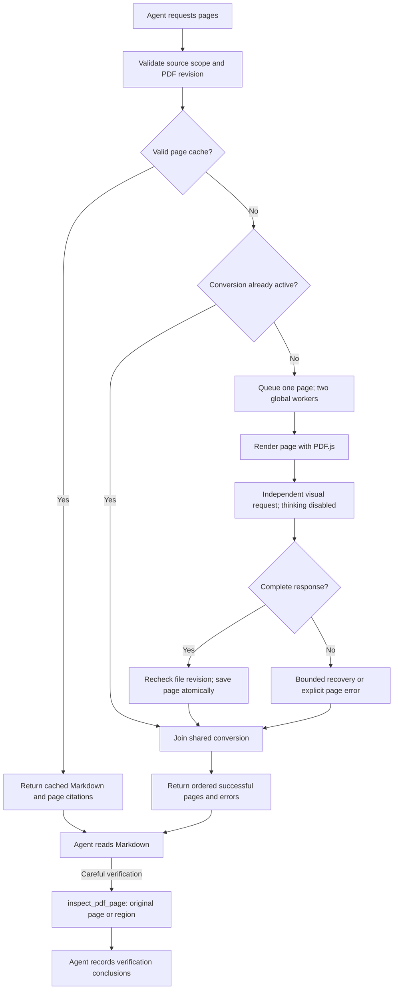

# On-demand page Markdown and original-image review

## Reading contract

Native chat and MCP use the same registry and executor. `read_pdf_page` returns ordered per-page Markdown and original Zotero PDF citations. Select one page, an ordered page list, or a consecutive range (default four pages, not a cap). Its network/costly metadata is explicit: uncached pages invoke the configured LLM API. No page images enter the main agent's context through this tool.

`inspect_pdf_page` preserves original-image access for careful review: full-page images at 200 DPI by default, normalized crops at 600 DPI, explicit DPI overrides, batch labels and citations. Review never overwrites Markdown. Important formulas, table values, figures and uncertain transcription should be checked visually. Cached transcription is not a scientific correctness certificate.

## Conversion and settings

The PDF transcription selector defaults to the captured current chat settings. It can instead reference an existing named visual-model profile, including that profile's endpoint, credentials and token limits. Thinking is disabled and saved reasoning effort is suppressed only for conversion. Each request contains the fixed transcription instruction and one page image, without chat history or agent tools. The page is rendered using Zotero PDF.js at 300 DPI (actual DPI is reported); existing image/raster safety limits still apply.

Provider-specific thinking controls are sent for compatible endpoints. An endpoint that cannot disable reasoning must return an explicit error; the pipeline never silently enables thinking or changes model. A missing selected profile fails only uncached reads. MCP uses ChatPDF's configuration, not the external host's private model configuration.

The transcription preserves original language, equations and numbering, tables, captions, references and page-boundary fragments. It labels uncertain content and model-written figure descriptions. The program attaches page identity and citations. A genuinely blank page is represented explicitly by `[BLANK PAGE]`. Formula syntax, symbol counts and text-layer coverage are not automatic rejection gates.

## Cache and concurrency

Each page is atomically saved under `pdf-markdown/<libraryID-key>/page-<number>.json`. Records bind source identity, file path/size/modification-time stamp, page number, total pages and transcription format version. They contain a SHA-256 digest of the Markdown, model name, time, resolution, attempts and reported conversion usage, without credentials or image bytes. The existing file-stamp boundary applies: same-size modifications with an unchanged timestamp are not detected.

A normal read reuses a valid cache across conversations and model changes; it makes no rendering or model call. `refresh=true` explicitly replaces only requested pages. Legacy whole-document caches and jobs are neither migrated nor resumed. A cache-save failure returns the usable transcription with an explicit not-saved warning and leaves the previous cache intact.

At most two page conversions run globally across native windows and MCP sessions. Concurrent reads of the same source/page/version share one conversion. A caller cancellation detaches only that subscriber; the final subscriber's cancellation aborts the active or queued task. Shutdown cancels all tasks. Source scope and PDF revision are checked before work and before delivery; stale results are never returned as current evidence.

## Failures and accounting

A page has at most 180 seconds for capability resolution and model requests after rendering. The existing transport retries transient pre-output HTTP/network failures at most twice. One complete but empty response gets one additional generation attempt. Truncated responses, missing completion markers, authentication errors and explicit image rejection are not repeatedly resubmitted as content retries. No partial response is written as a successful page cache.

Pages succeed or fail independently. A batch preserves successful pages and lists failures individually. A subsequent read converts only missing/failed pages. A helper error does not disable the main agent's image tools. Original-image review remains independently available.

Each physical conversion response is accounted once to an active reader, including empty/truncated attempts; shared subscribers and cache hits add no duplicate model usage. Native request history distinguishes `pdf-transcription` from agent requests. Metadata logs distinguish page reads from conversion responses and record model, page, cache/shared delivery, queue/render/model/write durations, finish reason and usage. Log records omit prompts, credentials and image data.

## Validation boundary

Unit tests exercise caching, corruption/invalidation, independent page failures, shared cancellation, concurrency, usage accounting, model selection, thinking controls and original-image delivery. Isolated Zotero tests use synthetic PDFs, local mock endpoints and dummy credentials to verify actual rendering, panel requests, cache persistence and native/MCP parity. Such fixtures establish runtime behavior; they do not establish real-model transcription accuracy or a real-paper speedup.
