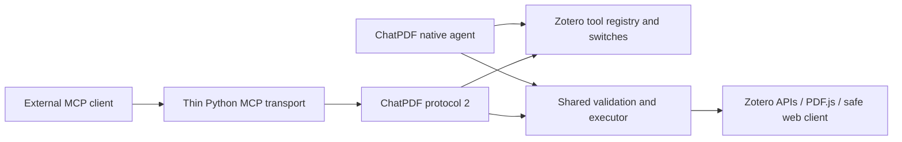

# Shared native and MCP tool channel

Decision: 2026-10-20; inventory updated 2026-10-23. Zotero owns all tool definitions and execution. Native ChatPDF chat and the companion Zotero MCP use the same names, descriptions, JSON schemas and executor. Each tool is individually enabled or disabled in preferences; all 25 are enabled by default.

## Ownership

- `tool-registry.ts` owns schemas, ordering and scheduling metadata.
- `tool-settings.ts` stores a JSON array of disabled names in `disabledTools`. Missing preferences enable all tools, including future additions. The retired `enableWebTools` preference is no longer used.
- `executeTool()` validates arguments and current switches before dispatch. It also handles source scope, domain authorization, complete text results and image callbacks.
- `agent-loop.ts` schedules native calls, attaches provider image input and manages the chat context.
- `tool-channel.ts` adapts independent external sessions, cancellation, complete result memory and image output to the same executor.
- Python MCP discovers the live catalog and forwards arguments/results. It has no separate tool inventory, PDF parser, cache reader, Zotero data API, search index or mutation engine.

Native chat calls the executor in-process. External MCP reaches that same executor through loopback transport. ChatPDF does not require MCP to run and does not import arbitrary third-party MCP servers.

## Tool inventory

| Purpose | Tools |
| --- | --- |
| Document sources and images | `list_sources`, `add_zotero_item_to_session`, `list_images`, `read_image` |
| PDF retrieval, location, Markdown and original-image review | `search_pdf_text`, `locate_pdf_content`, `get_document_status`, `read_pdf_text`, `read_pdf_page`, `inspect_pdf_page` |
| Zotero metadata, annotations and selection | `search_zotero_library`, `search_zotero_annotations`, `get_zotero_item`, `get_current_zotero_selection`, `list_zotero_collections`, `list_collection_items` |
| Notes and scoped changes | `read_zotero_notes`, `search_zotero_notes`, `change_zotero_library` |
| Public web | `web_search`, `web_fetch` |
| Installed source inspection | `list_plugin_source`, `read_plugin_source`, `search_plugin_source` |
| Complete stored results | `read_tool_result` |

Web search uses Brave when a key is configured and otherwise the existing DuckDuckGo fallback. No new search credential is required by the shared channel. Public network access still uses `SafeWebClient`.

`locate_pdf_content` reuses page-mapped local text to find candidate pages, then caches their text geometry. Both channels return the same matches, crop regions and citations. It does not perform semantic search, OCR or image/model requests. See [Content location and region citations](pdf-content-location.md) for matching behavior, precision and host compatibility.

## Protocol

The bridge is a custom loopback transport at `POST /chatpdf/v2`; the companion Python process exposes standard MCP over stdio or loopback Streamable HTTP.

Requests have `{protocol_version: 2, op, params}`. Responses have `{protocol_version: 2, ok: true, result}` or a sanitized `error` with `retryable: false`.

| Operation | Parameters / result |
| --- | --- |
| `status` | Actual capabilities, plugin/Zotero versions and enabled names; no credentials or cache paths |
| `tools.list` | Live enabled schemas and risk metadata |
| `tools.call` | `client_id`, `request_id`, `name`, `arguments`; text/image content plus `isError` |
| `tools.cancel` | Cancel only the matching `client_id` and `request_id` |
| `session.close` | Abort pending work and release that external session |

Session/request identifiers are opaque 16-128 character strings. The proxy creates random identifiers rather than exposing host identifiers. It uses HTTP/1.1, ignores environment proxies, and serializes data requests. Cancellation has its own control request. A failed or timed-out call is never automatically replayed, especially a potentially completed write.

The bridge rejects browser-origin requests and incompatible protocols. Old `/chatpdf/v1`, `selection.get`, conversion operations and legacy MCP tool aliases are retired. The retained CLI `research`/`connector` names both expose the same live catalog; clients that require the historical two-tool `search`/`fetch` contract need a separate integration.

## Scope, writes and limits

`list_collection_items` defaults to `detail=brief`: it returns every matching item's identity and discovery metadata, including whether an abstract exists, without abstract bodies. `detail=full` includes complete abstracts; `get_zotero_item` can retrieve individual records on demand. The response declares its detail mode. Only an explicitly supplied `max_results` limits the number of items; neither mode silently truncates abstracts. Other metadata tools retain their existing behavior.

`search_pdf_text` requires `library_id` whenever `collection_key` is supplied. Both parameter descriptions and the tool description explain this dependency and identify `list_zotero_collections` as the source of the matching values. Invalid collection scope fails before library enumeration; library-wide searches can still omit both fields. The default search mode now paginates matching PDFs; explicit `mode=passages` paginates complete merged passages.

MCP sessions start with no sources. Add relevant PDFs/images explicitly; a connection cannot read another connection's source list or stored result IDs. Native chat source mentions still define its TurnScope. External calls use their own session's sources, not the open chat's sources.

Library edit scope is captured from Zotero at the start of each external call. Default batch review uses the same concrete preview and trusted user click in the ChatPDF panel. If the panel is unavailable, approval is not granted. Read-only mode, library editability, transactions, revision conflicts and Undo remain shared. Disabling the change tool while review is pending prevents the mutation.

Text results remain complete; `read_tool_result` supports exact rereading. Native page images become provider `image_url` input; MCP receives standard `image` content with MIME type and base64 bytes. The 10 MiB per-image limit remains, with no cumulative byte quota per native turn or external call. The inspect_pdf_page schema supports single pages, ordered page lists, consecutive batches (default four), and normalized region crops up to 600 DPI. Each image has a source/page/region label. The renderer reports any resolution reduction; speculative adjacent pages remain local until requested.

Up to 32 external sessions can be open; one active call per external session is allowed. Proxy shutdown closes its sessions, and Zotero shutdown cancels all outstanding external work. The proxy request timeout defaults to 300 seconds and is configurable from 1 to 900 seconds. An abruptly killed process can leave an idle session until Zotero reloads; the session limit returns an explicit error.

Tool discovery is refreshed on MCP listing and dispatch. A host may cache its displayed tool list until reconnecting; the executor rejects disabled calls immediately regardless. Changing switches also changes the native tool fingerprint on the next turn.

## Validation boundary

Unit and transport tests verify catalog parity, argument validation, disabled calls, full text/image forwarding, session separation, cancellation and write revocation. Isolated Zotero testing uses fixture PDFs and a mock model; standard MCP requests exercise the real bridge and renderer. These checks do not establish real-model formula accuracy or verify every external host. A running pre-migration Zotero/client must be upgraded together before it can use this channel.

## Image-input observations

The shared catalog marks image-producing tools with `requiresImageInput`. No model metadata gates discovery. After an explicit provider image rejection, the native caller filters those tools for its live session/model and passes `imageInputRejected` to the same executor to reject stale calls. Global switches stay unchanged. An external MCP host owns its model requests; the bridge cannot observe provider rejections and still offers the enabled catalog.

## Document discovery and passage search

One `search_pdf_text` tool serves both native chat and MCP. The default `mode=documents` returns one entry per matching PDF, with source identity, title, total literal match count, total merged passage count, matching PDF pages when available, and representative snippets. `mode=passages` returns every merged snippet window in page order. Use the returned library-qualified `source_id` to inspect one PDF within the same scope filters. Neither mode adds documents to the session or calls a model.

Defaults are explicit: `page_size=20` matching PDFs in document mode or merged passages in passage mode, `documents_per_call=25` text inspections, `snippet_chars=240` for initial context windows, and `snippets_per_document=2` representative passages per document. Overlapping windows merge without truncation and can exceed `snippet_chars`. Document results declare how many passages were not shown; passage pagination recovers them all. File metadata checks for cursor validity do not count as text inspections.

Discovery advances between PDFs, so repeated headers in one PDF cannot consume the result batch. Page-mapped text uses a repeated-edge-line heuristic to rank likely margins after other passages. This only changes representative-snippet priority: all occurrences remain available, and a PDF matching only in its headers still appears. A flat Zotero index reports unknown page locations and performs no header classification.

`progress` reports inspections this call, newly scanned PDFs, cumulative scanned/matching/searchable PDFs, and complete-text, partial-text, no-extractable-text and unavailable counts. `scan_complete` means every candidate was inspected; `traversal_complete` means no result cursor remains. In passage mode all PDFs may have been inspected while more passages remain. `text_coverage_complete` describes reported text records, not OCR completeness, visual content or formula fidelity. A fully traversed collection can still contain unavailable files or pages without extractable text.

For exhaustive discovery, follow `next_cursor` with the same search arguments until `traversal_complete`. Cursors bind mode, query, scope, snippet settings, item revisions and PDF file stamps; a partially returned PDF also binds its text representation. Changing a relevant input or PDF invalidates the cursor instead of silently mixing revisions. `page_size` and `documents_per_call` may change between pages. The native prompt distinguishes stopping early from completing a search with incomplete text coverage, then directs ordinary reading to cached page Markdown and careful review to original images.

Regression coverage includes 44 PDFs with 70 repeated header matches in the first PDF and later matching PDFs, full recovery of all 71 passages from that first PDF, header-only matches, merged occurrence counts, unavailable/empty/partial coverage, stale cursors, flat-index transitions and cancellation.

## Page Markdown transcription

`read_pdf_page` returns ordered page-level Markdown and citations, with per-page cache/error metadata. Cache misses make billed visual-model requests inside Zotero, using the current ChatPDF model or its selected transcription profile with thinking disabled. Metadata marks this read-only tool as network/costly; it does not require image input from the calling agent. `inspect_pdf_page` alone returns original PDF images. Both callers share cache entries, conversion concurrency and cancellation logic; external agents do not supply or reveal their own model credentials. Refresh the MCP tool catalog after upgrading. Legacy conversion operations remain retired. See [Page transcription](pdf-markdown-reading.md).
