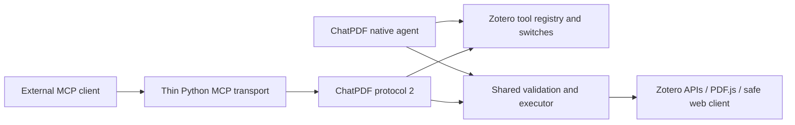

# Shared native and MCP tool channel

Decision: 2026-10-20. Zotero owns all tool definitions and execution. Native ChatPDF chat and the companion Zotero MCP use the same names, descriptions, JSON schemas and executor. Each tool is individually enabled or disabled in preferences; all 23 are enabled by default.

## Ownership

- `tool-registry.ts` owns schemas, ordering and scheduling metadata.
- `tool-settings.ts` stores a JSON array of disabled names in `disabledTools`. Missing preferences enable all tools, including future additions. The retired `enableWebTools` preference is no longer used.
- `executeTool()` validates arguments and current switches before dispatch. It also handles source scope, domain authorization, complete text results and image callbacks.
- `agent-loop.ts` schedules native calls, attaches provider image input and manages the chat context.
- `tool-channel.ts` adapts independent external sessions, cancellation, complete result memory and image output to the same executor.
- Python MCP discovers the live catalog and forwards arguments/results. It has no separate tool inventory, PDF parser, cache reader, Zotero data API, search index or mutation engine.

Native chat calls the executor in-process. External MCP reaches that same executor through loopback transport. ChatPDF does not require MCP to run and does not import arbitrary third-party MCP servers.

## Tool inventory

| Purpose | Tools |
| --- | --- |
| Document sources and images | `list_sources`, `add_zotero_item_to_session`, `list_images`, `read_image` |
| PDF retrieval and original pages | `search_pdf_text`, `get_document_status`, `read_pdf_text`, `read_pdf_page` |
| Zotero metadata, annotations and selection | `search_zotero_library`, `search_zotero_annotations`, `get_zotero_item`, `get_current_zotero_selection`, `list_zotero_collections`, `list_collection_items` |
| Notes and scoped changes | `read_zotero_notes`, `search_zotero_notes`, `change_zotero_library` |
| Public web | `web_search`, `web_fetch` |
| Installed source inspection | `list_plugin_source`, `read_plugin_source`, `search_plugin_source` |
| Complete stored results | `read_tool_result` |

Web search uses Brave when a key is configured and otherwise the existing DuckDuckGo fallback. No new search credential is required by the shared channel. Public network access still uses `SafeWebClient`.

## Protocol

The bridge is a custom loopback transport at `POST /chatpdf/v2`; the companion Python process exposes standard MCP over stdio or loopback Streamable HTTP.

Requests have `{protocol_version: 2, op, params}`. Responses have `{protocol_version: 2, ok: true, result}` or a sanitized `error` with `retryable: false`.

| Operation | Parameters / result |
| --- | --- |
| `status` | Actual capabilities, plugin/Zotero versions and enabled names; no credentials or cache paths |
| `tools.list` | Live enabled schemas and risk metadata |
| `tools.call` | `client_id`, `request_id`, `name`, `arguments`; text/image content plus `isError` |
| `tools.cancel` | Cancel only the matching `client_id` and `request_id` |
| `session.close` | Abort pending work and release that external session |

Session/request identifiers are opaque 16-128 character strings. The proxy creates random identifiers rather than exposing host identifiers. It uses HTTP/1.1, ignores environment proxies, and serializes data requests. Cancellation has its own control request. A failed or timed-out call is never automatically replayed, especially a potentially completed write.

The bridge rejects browser-origin requests and incompatible protocols. Old `/chatpdf/v1`, `selection.get`, conversion operations and legacy MCP tool aliases are retired. The retained CLI `research`/`connector` names both expose the same live catalog; clients that require the historical two-tool `search`/`fetch` contract need a separate integration.

## Scope, writes and limits

MCP sessions start with no sources. Add relevant PDFs/images explicitly; a connection cannot read another connection's source list or stored result IDs. Native chat source mentions still define its TurnScope. External calls use their own session's sources, not the open chat's sources.

Library edit scope is captured from Zotero at the start of each external call. Default batch review uses the same concrete preview and trusted user click in the ChatPDF panel. If the panel is unavailable, approval is not granted. Read-only mode, library editability, transactions, revision conflicts and Undo remain shared. Disabling the change tool while review is pending prevents the mutation.

Text results remain complete; `read_tool_result` supports exact rereading. Native page images become provider `image_url` input; MCP receives standard `image` content with MIME type and base64 bytes. Limits remain explicit: 10 MiB per image, 20 MiB per native turn or external call. The renderer also reports resolution reductions.

Up to 32 external sessions can be open; one active call per external session is allowed. Proxy shutdown closes its sessions, and Zotero shutdown cancels all outstanding external work. The proxy request timeout defaults to 300 seconds and is configurable from 1 to 900 seconds. An abruptly killed process can leave an idle session until Zotero reloads; the session limit returns an explicit error.

Tool discovery is refreshed on MCP listing and dispatch. A host may cache its displayed tool list until reconnecting; the executor rejects disabled calls immediately regardless. Changing switches also changes the native tool fingerprint on the next turn.

## Validation boundary

Unit and transport tests verify catalog parity, argument validation, disabled calls, full text/image forwarding, session separation, cancellation and write revocation. Isolated Zotero testing uses fixture PDFs and a mock model; standard MCP requests exercise the real bridge and renderer. These checks do not establish real-model formula accuracy or verify every external host. A running pre-migration Zotero/client must be upgraded together before it can use this channel.
